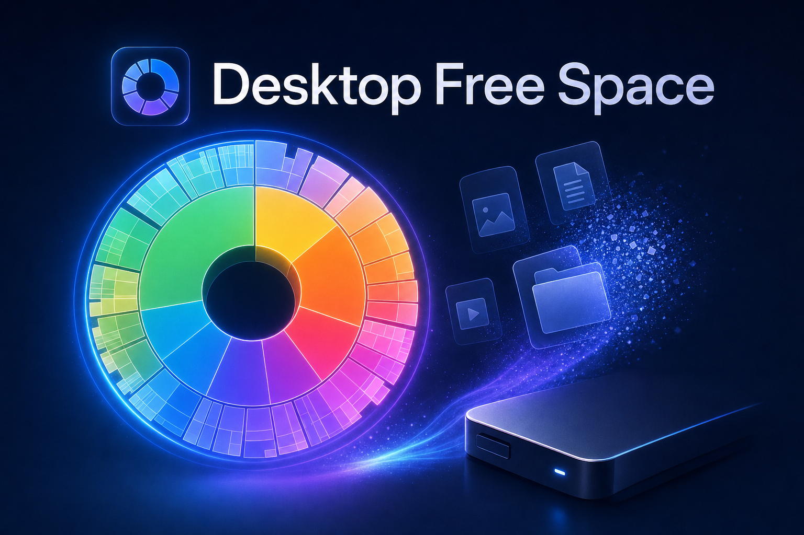

<div align="center">



# Desktop Free Space

**Descubre qué está llenando tu disco y libera espacio sin miedo a romper nada.**

Aplicación de escritorio para **Windows, macOS y Linux**, con interfaz oscura, que dibuja un mapa interactivo de tus discos, encuentra temporales, cachés, modelos de IA, duplicados y restos de programas desinstalados, y te deja borrarlos con seguridad.


[Descargar](#-descarga) · [Funcionalidades](#-funcionalidades) · [Instalación](#-instalación-desde-el-código) · [Seguridad](#-seguridad)

</div>

---

## ✨ Funcionalidades

### Discos
- Espacio libre, usado y total del disco del sistema, con un anillo de uso, y una fila con barra de capacidad para cada uno del resto de discos. **Se actualiza en tiempo real**, sin tener que analizar.
- Tamaño de la **Papelera**, con botón para vaciarla.
- Archivos de hibernación y memoria virtual (`hiberfil.sys`, `pagefile.sys`, `/swapfile`, `sleepimage`), con consejos para reducirlos, e instantáneas locales de Time Machine en macOS.
- Accesos directos a las herramientas del sistema: Liberador de espacio y Sensor de almacenamiento en Windows, Almacenamiento y Utilidad de Discos en macOS, Analizador de uso de disco en Linux.

### Mapa del disco
- **Mapa de anillos interactivo**, suavizado y animado: cada anillo es un nivel de carpetas, el tamaño de cada arco es lo que ocupa y los colores siguen un arcoíris por posición.
- Los **archivos grandes** (1 MB o más) aparecen como segmentos propios dentro de su carpeta, además de las carpetas.
- **Espacio oculto**: al analizar un disco entero, la diferencia entre lo usado y lo que se ha podido leer aparece como un segmento gris (archivos del sistema, carpetas sin permisos, instantáneas).
- Pasa el ratón para ver el tamaño y el porcentaje; haz clic para entrar en una carpeta y en el centro para subir. Animación de progreso mientras analiza.
- **Vista previa rápida** (tecla Espacio o clic en un archivo del mapa): imágenes, texto o el contenido de la carpeta, con botones para mostrarlo o mandarlo al Colector.
- Ruta de navegación, lista ordenada por tamaño con barra de porcentaje y menú contextual (vista previa, mostrar en el gestor de archivos, copiar ruta, añadir al Colector, borrar).
- **Exportar a CSV** el resultado del análisis.
- En macOS y Linux cuenta el espacio físico real (bloques ocupados) y los enlaces duros una sola vez.

### Colector
- Una cesta en la barra lateral: **arrastra** ahí segmentos del mapa o filas de cualquier lista (mapa, archivos grandes, duplicados, modelos, restos) y bórralos todos juntos al final, revisando la lista completa antes.

### Tipos de archivo
- Cuánto ocupan los vídeos, imágenes, modelos de IA, comprimidos, código, documentos…, con una barra apilada y la tabla de extensiones que más ocupan.
- Doble clic en una extensión para ver sus archivos más grandes.

### Limpieza por categorías
Calcula cuánto ocupa cada categoría y la marca como **Seguro** (se regenera sola) o **Revisar** (habría que volver a descargarlo). Las categorías se adaptan a cada sistema:

| Grupo | Qué limpia |
|---|---|
| **Sistema** | Temporales, Windows Update, volcados de memoria, caché de miniaturas, registros, cachés de la GPU, caché de paquetes (apt, dnf, pacman) |
| **Navegadores y apps** | Cachés de Chrome, Edge, Brave, Opera, Firefox y Safari (sin tocar contraseñas, historial ni sesiones) y de apps Electron como VS Code, Cursor, Discord, Slack, Teams o Spotify |
| **Desarrollo** | pip, uv, Poetry, Conda, npm, yarn, pnpm, bun, Deno, Gradle, Android, Maven, NuGet, Cargo, Go, PlatformIO, Homebrew, Xcode (DerivedData, simuladores y archivos), JetBrains y Unity |
| **IA / Modelos** | Hugging Face, Ollama, LM Studio, PyTorch Hub, Whisper, Keras, DeepFace, rembg, ModelScope, InsightFace, EasyOCR, GPT4All y Jan |

### Archivos grandes
- Los 1000 archivos más pesados del último análisis, con fecha de modificación.
- Filtros por tamaño mínimo, por extensión o nombre y por **antigüedad** (sin tocar en 6 meses, 1 año o 2 años).

### Duplicados
- Encuentra archivos idénticos comparando tamaño y huella del contenido (BLAKE2), sin falsos positivos y sin contar dos veces los enlaces duros.
- **Marcar copias** deja el original y marca el resto para enviarlo al Colector.

### Modelos IA
- Lista los **modelos de Ollama por su nombre** (`llama3:latest`…) con su tamaño real y los elimina con `ollama rm`.
- Encuentra archivos de modelos de 50 MB o más (`.gguf`, `.safetensors`, `.ckpt`, `.pt`, `.onnx`, `.bin`…) e indica su probable origen.

### Aplicaciones
- Programas instalados: registro de Windows, apps de `/Applications` en macOS, y paquetes `dpkg`, `rpm`, `pacman`, Flatpak y Snap en Linux.
- Abre el desinstalador oficial (Windows), envía la app a la Papelera (macOS) o te da el comando para desinstalar (Linux).
- **Posibles restos**: carpetas de 20 MB o más en AppData y ProgramData, en `~/Library` o en `~/.config` y `~/.local/share` que no coinciden con ninguna aplicación instalada.

---

## 🔄 Actualizaciones automáticas

- Unos segundos después de abrirse, la app mira en segundo plano si hay una versión nueva en las [releases de GitHub](https://github.com/crazyramirez/desktop-free-space/releases). Si no hay conexión, no dice nada.
- Si la hay, aparece un aviso arriba con **Actualizar ahora**, **Ver novedades** y **Omitir esta versión**. Nunca se actualiza sola: siempre tienes que pulsar tú.
- La descarga se comprueba con su huella **SHA-256** publicada en GitHub; si no coincide, no se instala.
- Al terminar, **Reiniciar para terminar** cierra la app, cambia el ejecutable (en Windows se guarda una copia `.old`) y la vuelve a abrir. En macOS se copia la nueva `.app` encima de la actual (si no hay permisos, se abre el `.dmg` para que la arrastres a Aplicaciones); en Linux se sustituye el binario.
- **Buscar actualizaciones**, en la tarjeta del sistema de la barra lateral, lo comprueba cuando quieras.
- La opción de omitir una versión se guarda en `settings.json`, en `%APPDATA%\DesktopFreeSpace` (Windows), `~/Library/Application Support/DesktopFreeSpace` (macOS) o `~/.config/DesktopFreeSpace` (Linux).

---

## 🛡 Seguridad

Desktop Free Space está pensado para que no puedas romper el sistema por accidente:

- **Nada se borra sin confirmación.** Antes de borrar siempre ves la lista completa de lo que se va a eliminar y su tamaño.
- **Papelera o borrado definitivo**, a elegir en cada borrado.
- **Rutas protegidas** que nunca se borran: la raíz de los discos, `C:\Windows` (salvo temporales, Windows Update y volcados), `System Volume Information`, `Recovery`, `EFI`; en macOS y Linux `/System`, `/usr`, `/bin`, `/etc`, `/lib`, `/boot`, `/var/lib`, `/Library`, tus llaves (`~/.ssh`, `~/.gnupg`, Llaveros), y las carpetas base de tu usuario (Escritorio, Documentos, Descargas…). De estas últimas puedes borrar el contenido, pero no la carpeta.
- **Aviso en Archivos de programa, `/Applications` y `/opt`**: recomienda desinstalar antes que borrar la carpeta.
- No sigue enlaces simbólicos ni *junctions* y no entra en `/proc`, `/sys` ni `/dev`.
- Los archivos de OneDrive que solo están en la nube cuentan como 0 bytes.
- Los archivos en uso se saltan sin error.
- Los «posibles restos» son una estimación. Revísalos antes de borrarlos.

---

## 📥 Descarga

Descarga la última versión desde [**Releases**](../../releases/latest):

| Sistema | Archivo | Cómo abrirlo |
|---|---|---|
| Windows | `DesktopFreeSpace-Windows.exe` | Doble clic. No hay que instalar nada. |
| macOS | `DesktopFreeSpace-macOS.dmg` | Abre el .dmg y arrastra la app a Aplicaciones. |
| Linux | `DesktopFreeSpace-Linux-x86_64.tar.gz` | `tar xzf DesktopFreeSpace-Linux-x86_64.tar.gz && ./DesktopFreeSpace/DesktopFreeSpace` |

> **Aviso.** Los ejecutables no están firmados. En Windows, SmartScreen puede avisarte: pulsa *Más información* y *Ejecutar de todas formas*. En macOS, la primera vez haz clic derecho en la app y elige *Abrir*.

Para limpiar temporales del sistema hacen falta permisos de administrador. En Windows usa **Reiniciar como admin** en la barra lateral; en macOS y Linux, las categorías que lo necesitan lo indican.

---

## 🛠 Instalación desde el código

Necesitas **Python 3.10 o superior** con tkinter (en Ubuntu/Debian: `sudo apt install python3-tk`).

```bash
git clone https://github.com/crazyramirez/desktop-free-space.git
cd desktop-free-space
python -m venv .venv
# Windows: .venv\Scripts\activate    ·    macOS/Linux: source .venv/bin/activate
pip install -r requirements.txt
python app/main.py
```

### Generar el ejecutable

- **Windows:** doble clic en **`build.bat`** → `dist\DesktopFreeSpace.exe`.
- **macOS / Linux:** `./build.sh` → `dist/DesktopFreeSpace.app` o `dist/DesktopFreeSpace`.

**GitHub Actions** (`.github/workflows/build.yml`) compila las tres versiones en cada push a `main` y publica una **Release** `v<versión>` con los tres archivos. Solo se conserva la última release: las anteriores, sus etiquetas, las ejecuciones antiguas de Actions y los artifacts se borran automáticamente.

---

## 🚀 Uso rápido

1. Abre **Discos** para ver cuánto espacio libre te queda. Desde ahí, **Limpiar temporales y cachés** calcula lo que se puede borrar sin riesgo y **Ver qué ocupa espacio** abre el mapa del disco.
2. En **Mapa del disco**, analiza tu disco o tu carpeta de usuario y recorre los anillos para ver qué ocupa más.
3. Ve a **Limpieza**, pulsa **Calcular espacio**, después **Marcar las seguras** y **Limpiar seleccionadas**.
4. Revisa **Duplicados**, **Archivos grandes** (filtra por antigüedad) y **Modelos IA**: suelen ser lo que más espacio recupera.
5. Lo que quieras borrar, échalo al **Colector** y bórralo todo junto al final.

---

## 🧱 Estructura del proyecto

```
desktop-free-space/
├── app/
│   ├── core.py        # Lógica: análisis, categorías por sistema, duplicados, protección de rutas y borrado
│   └── main.py        # Interfaz gráfica (customtkinter + mapa de anillos en tk.Canvas)
├── assets/            # Iconos (icon.ico, icon.png)
├── docs/hero.png      # Imagen de portada
├── build.bat          # Genera el .exe (Windows)
├── build.sh           # Genera la app (macOS) o el binario (Linux)
├── requirements.txt
└── .github/workflows/build.yml
```

**Tecnologías:** Python, [customtkinter](https://github.com/TomSchimansky/CustomTkinter), [Send2Trash](https://github.com/arsenetar/send2trash) y [PyInstaller](https://pyinstaller.org).

---

## 📄 Licencia

[MIT](LICENSE) © 2026 crazyramirez
